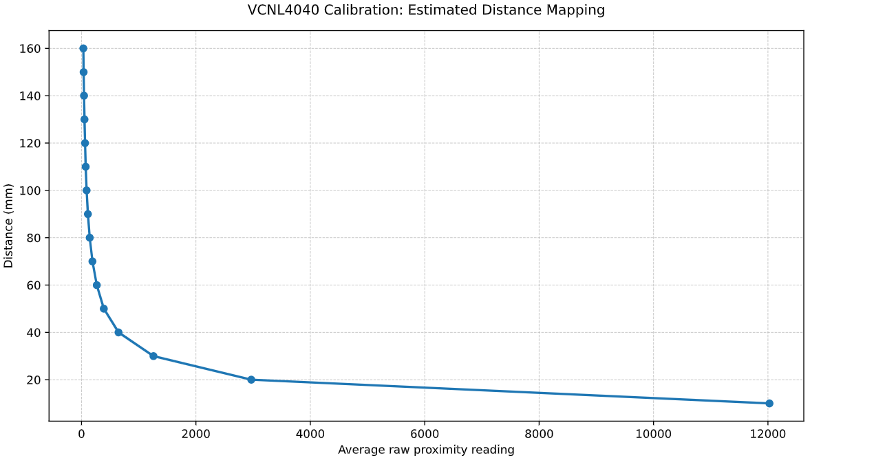
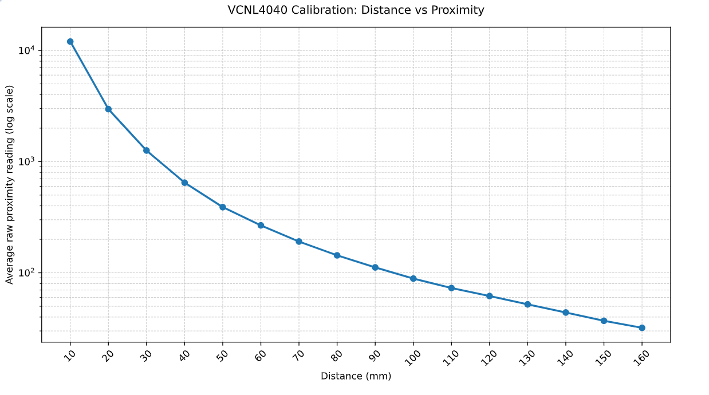

# VCNL4040 Distance Measurement

Arduino-based distance measurement using the SparkFun VCNL4040 proximity sensor.

The sketch converts raw proximity readings into estimated distances (mm) using an experimentally calibrated lookup table and linear interpolation.

## Hardware Requirements
- Arduino Micro / compatible Arduino board
- VCNL4040 proximity sensor (e.g. SparkFun Qwiic breakout)
- I2C connections (SDA, SCL, 3.3V/5V per your breakout, GND)

## Software Requirements
- Arduino IDE
- [SparkFun VCNL4040 Arduino Library](https://github.com/sparkfun/SparkFun_VCNL4040_Arduino_Library) (install via Library Manager)

## Quick Start
1. Clone this repo and open `VCNL4040_Distance/VCNL4040_Distance.ino`.
2. Install the SparkFun VCNL4040 library.
3. Select your board and port, then upload.
4. Open the Serial Monitor at **9600 baud**.

## Features
- VCNL4040 sensor initialization
- Raw proximity measurement
- Five-sample averaging
- Calibration-based distance estimation
- Linear interpolation
- Serial Monitor output

## Calibration Data

| Distance (mm) | Proximity Reading |
|---:|---:|
| 10 | 12027 |
| 20 | 2968.1 |
| 30 | 1258.1 |
| 40 | 646.9 |
| 50 | 389.7 |
| 60 | 267.1 |
| 70 | 191.1 |
| 80 | 143.6 |
| 90 | 111.9 |
| 100 | 88.8 |
| 110 | 73 |
| 120 | 61.8 |
| 130 | 52 |
| 140 | 44 |
| 150 | 37 |
| 160 | 32 |

### Calibration plots

Distance vs. raw proximity (linear axes):



Raw proximity vs. distance (log scale):



The response is strongly non-linear: the signal falls off steeply with distance, so resolution is best at close range and degrades toward 160 mm.

## Working Principle
1. Read proximity values from the VCNL4040.
2. Average five consecutive readings.
3. Compare the average with the calibration table.
4. Apply linear interpolation between the two nearest calibration points.
5. Display the estimated distance in millimeters.

## Output
Example:

```
Raw Proximity: 646.9 | Estimated Distance: 40.00 mm
```

If the reading is outside the table, the sketch prints `Outside calibrated range` (the function `calculateDistance()` returns `-1`).

## Recalibrating
To calibrate for your own target and environment:
1. Place the target at each distance (10–160 mm in 10 mm steps) and record the averaged raw proximity value.
2. Replace `distanceTable[]` and `proximityTable[]` in the sketch (values must be in **descending** order of proximity).
3. Update `TABLE_SIZE` if you change the number of points.

## Repository Structure
```
VCNL4040-Distance-Measurement/
├── VCNL4040_Distance/
│   └── VCNL4040_Distance.ino
├── docs/
│   ├── distance-vs-proximity-linear.png
│   └── distance-vs-proximity-log.png
├── .gitignore
└── README.md
```

## Limitations
- Accuracy depends on calibration conditions and target material/colour/size.
- Ambient light and sensor settings (LED current, integration time) affect readings; keep them the same as during calibration.
- Values outside the calibrated range (raw > 12027 or < 32) are not estimated.
- Linear interpolation on raw values is less accurate between widely spaced points at close range (10–30 mm).
- Calibrate for the actual target surface and environment.
